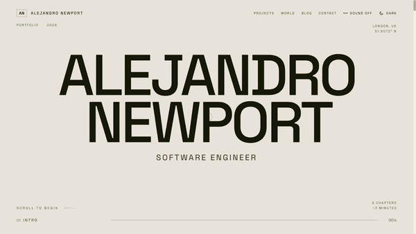
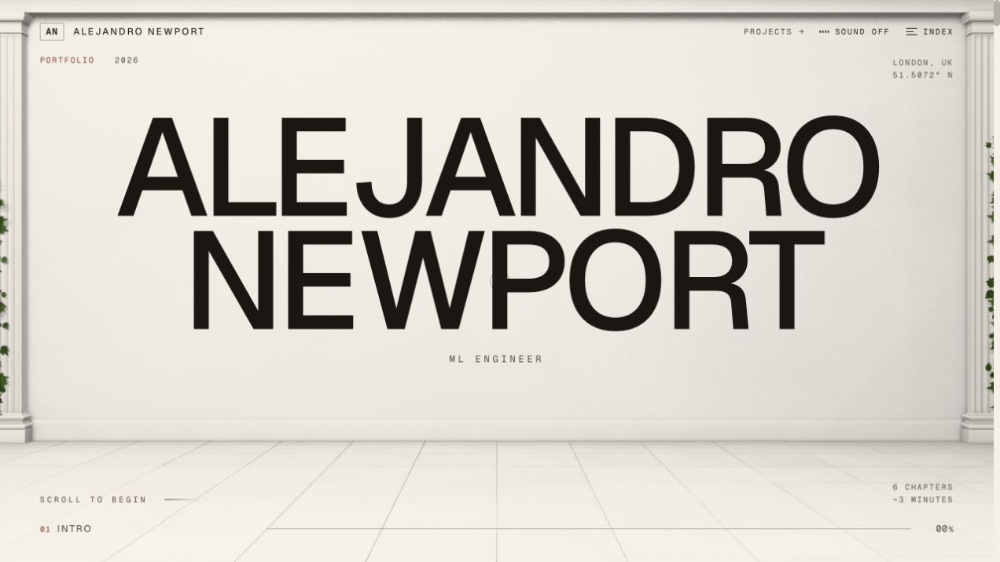
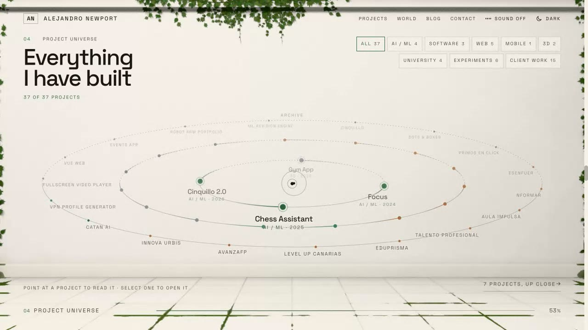
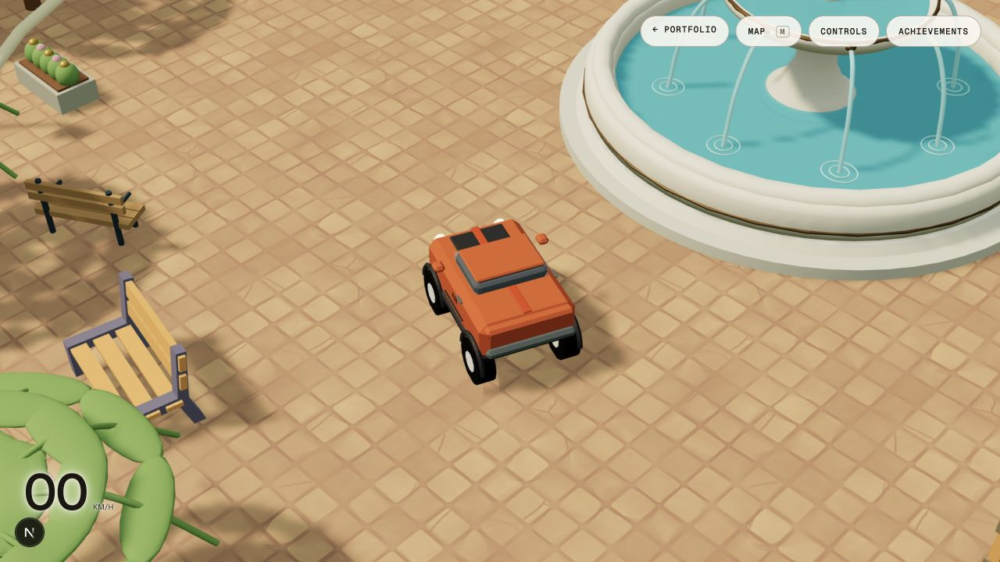
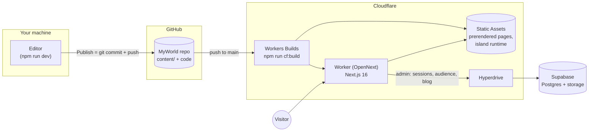

<p align="center">
  <a href="https://www.alenewport.com"></a>
</p>

<h1 align="center">MyWorld</h1>

<p align="center"><b>A developer portfolio you can read, explore and drive through: a scroll-led story that opens onto an explorable 3D island, built with Next.js, Three.js and Rapier physics.</b></p>

<p align="center">
  <a href="https://github.com/Ale-Newport/MyWorld/actions/workflows/ci.yml"></a>
  <a href="https://github.com/Ale-Newport/MyWorld/actions/workflows/codeql.yml"></a>
  <a href="https://github.com/Ale-Newport/MyWorld/releases"></a>
  <a href="LICENSE"></a>
  
  
  
  
</p>

<p align="center">
  <a href="https://www.alenewport.com"><b>Live site</b></a> ·
  <a href="https://www.alenewport.com/world"><b>Drive the island</b></a> ·
  <a href="#quick-start"><b>Run it locally</b></a> ·
  <a href="CHANGELOG.md">Changelog</a>
</p>

---

## Why it is interesting

Most portfolios are a page of cards. This one is two connected experiences that share one content model:

- **The story.** Six chapters scroll over a lit, real-time 3D room: an introduction, a career ribbon, a *Tech Toolbox* where every technology links to the projects that used it, and a **project universe** that puts 37 projects on orbits you can filter and open.
- **The world.** Keep scrolling and the garden takes over: leaves close over the page, part again, and you are on **Archipiélago**, an island you explore by car or plane, with districts for projects, career, education and achievements, a map with fast travel, mini-games, physics and synthesised sound.
- **The editor.** Content is edited in a local editor app and published *to git*; the site is prerendered from those files, so a visit reads no database.

## Features

| | |
| --- | --- |
| 🧭 **Scroll-led story** | Pinned chapters with 17 section animations, all with reduced-motion fallbacks; dark mode and a night version of the room |
| 🪐 **Project universe** | 37 projects on an orbital system with category filters; case studies open in an overlay that keeps its URL |
| 🏝️ **Explorable island** | Ray-cast vehicle on Rapier physics, driving and flying, keyboard and touch controls, map travel, signs and labels that face the camera |
| ⚡ **Fast** | Static pages from Cloudflare's edge; the island loads only when you go there. Time to drive fell from 8.1 s to 4.1 s and transfer from 28.5 MB to 12.9 MB in the last performance pass |
| ✍️ **Git-backed CMS** | A local editor (pages → sections → text and animations, device previews, drafts and revisions) whose *Publish* commits and pushes content |
| 📊 **Private analytics** | First-party audience statistics in the deployed admin; no third-party trackers |
| 🔒 **Hardened admin** | scrypt hashes, `__Host-` session cookies, CSRF and same-origin checks, login throttling, byte-typed uploads |

## Screenshots

<table>
  <tr>
    <td width="50%"></td>
    <td width="50%"></td>
  </tr>
  <tr>
    <td align="center"><sub>The introduction, rendered over a real-time 3D room</sub></td>
    <td align="center"><sub>The project universe: 37 projects, filterable by category</sub></td>
  </tr>
  <tr>
    <td colspan="2"></td>
  </tr>
  <tr>
    <td colspan="2" align="center"><sub>Archipiélago, the island at <code>/world</code></sub></td>
  </tr>
</table>

## Quick start

You need **Node.js 24 or 26 LTS** and npm. No database, cloud account or API key: the repository ships its content and the island's world document.

```bash
git clone https://github.com/Ale-Newport/MyWorld.git && cd MyWorld && npm ci && npm run dev:site
```

Open **<http://localhost:3000>**.

| Route | What you will see |
| --- | --- |
| `/` | The portfolio story |
| `/projects` | The project archive and case studies |
| `/world` | The island (needs a browser with WebGL) |
| `/blog`, `/contact` | The blog and the contact page |

**Controls on the island:** <kbd>W</kbd><kbd>A</kbd><kbd>S</kbd><kbd>D</kbd> or arrow keys to drive, <kbd>Space</kbd> to jump (twice to fly), <kbd>M</kbd> for the map. On a phone, press on the ground and drag: an on-screen joystick steers, and a tap on the car jumps.

### The editor

`npm run dev` starts the **editor** instead of the site: public pages redirect to `/admin`, where you edit pages, sections, animations and the world. Create a local account first:

```bash
npm run admin:create -- --email you@example.com --name "Your Name"
```

Local content, uploads and revisions live in `.data/cms/` (git-ignored). The [admin guide](docs/ADMIN.md) covers publishing, media and deployment; the [world guide](docs/ARCHIPELAGO_WORLD.md) covers the island's runtime and studio.

## Architecture



| Layer | Implementation |
| --- | --- |
| Site | Next.js 16 App Router, React 19, TypeScript, GSAP + Lenis for scroll |
| 3D | Three.js, React Three Fiber and drei for the room; a standalone ES-module runtime with Rapier for the island |
| Content | A versioned site document (zod schema + migrations), revisions, drafts; published to `content/` in git |
| Admin storage | SQLite + files locally; Supabase Postgres (via Hyperdrive) and private storage when deployed |
| Hosting | OpenNext on Cloudflare Workers, static pages from Workers Static Assets |

## Repository guide

| Path | Purpose |
| --- | --- |
| `src/app/` | Public routes, admin routes and API handlers |
| `src/sections/`, `src/components/` | Chapter composition and the portfolio interface |
| `src/experience/` | React Three Fiber scenes and visual systems |
| `src/world/`, `public/archipelago/` | The island runtime, its assets and seed |
| `src/server/` | Content store, authentication, revisions, media, blog, analytics |
| `src/cms/` | Site document schema, migration and the Markdown renderer |
| `content/` | The published site and world documents |
| `scripts/`, `tests/` | Generators, QA and performance harnesses, automated tests |

## Development

```bash
npm run lint        # ESLint
npm run typecheck   # TypeScript
npm test            # 680+ node:test tests: CMS, auth, media, world systems
npm run build       # Production build
npm run preview     # Build for Cloudflare and serve it on local workerd
```

CI runs lint, typecheck, tests, a dependency audit and a production build on every push and pull request; CodeQL scans every change to `main`. Deployment is `npm run deploy` (or Cloudflare Workers Builds on push); the production services and secrets are listed in [`.env.example`](.env.example) and the [admin guide](docs/ADMIN.md).

## Contributing

Bug fixes, performance and accessibility improvements, browser fixes, tests and docs are all welcome. The **content** (biography, projects, images) is the author's own and is not open for changes. Start with [CONTRIBUTING.md](CONTRIBUTING.md) and the issues labelled [`good first issue`](https://github.com/Ale-Newport/MyWorld/labels/good%20first%20issue); questions go to [Discussions](https://github.com/Ale-Newport/MyWorld/discussions).

Found a vulnerability? Please report it privately; see [SECURITY.md](SECURITY.md).

## Credits and licence

The island's engine (game loop, physics layer, ray-cast vehicle, camera and input) is ported and adapted from **Bruno Simon's [folio-2025](https://github.com/brunosimon/folio-2025)** (MIT); every ported file says so, and [THIRD_PARTY_NOTICES.md](THIRD_PARTY_NOTICES.md) details what was ported, adapted or written fresh.

The **code** is released under the [MIT License](LICENSE). The **personal content** (biography, project write-ups, images and identity) is © Alejandro Newport Diaz, all rights reserved: see [CONTENT_LICENSE.md](CONTENT_LICENSE.md). Build your own site from the code, with your own story in it.
