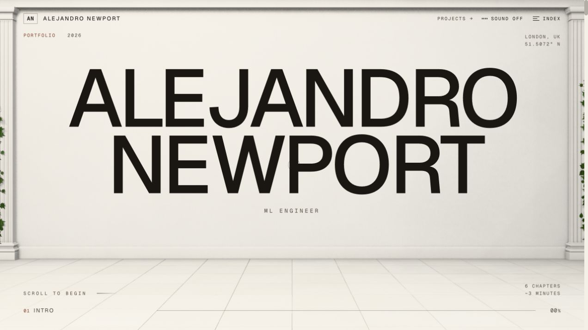
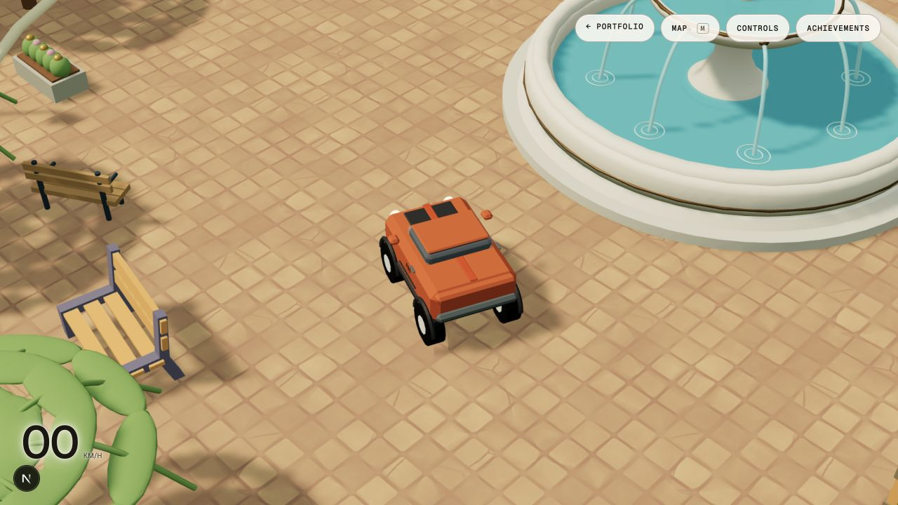

# MyWorld

### A portfolio you can read, explore and drive through.

Alejandro Newport's interactive portfolio combines a scroll-led story, a searchable project archive and an explorable 3D island. It brings software, AI and creative engineering work into one connected experience, backed by an administration workspace for editing and publishing content.

**Next.js · React · TypeScript · Three.js · React Three Fiber · Rapier**

[Visit the live portfolio](https://alejandro-newport-portfolio.anewportd.workers.dev) · [Explore the island](https://alejandro-newport-portfolio.anewportd.workers.dev/world) · [Run locally](#run-locally)



*The public portfolio, captured in October 2026. Published content can evolve independently of the source defaults.*

## Two ways to explore

**Follow the story.** Move through the portfolio's chapters, discover the technologies behind the work, and open project case studies. Quick View, an index and a readable HTML profile give visitors different ways through the same material.

**Enter the world.** Drive or fly around Archipiélago: discover project areas, career and education content, activities and achievements. The world includes its own map and travel controls.



## Run locally

Use **Node.js 24+** and npm. The local content store uses Node's built-in SQLite; no Supabase account or Cloudflare setup is needed to explore the project.

```bash
git clone https://github.com/Ale-Newport/MyWorld.git
cd MyWorld
npm ci
npm run dev
```

Open **[localhost:3000](http://localhost:3000)**. The repository includes default content and a world seed, so the public experience works before you create an administrator. Stop the server with `Ctrl+C`.

| Route | Explore |
| --- | --- |
| `/` | The portfolio journey |
| `/projects` | Project archive and case studies |
| `/world` | The interactive island; use a modern browser with WebGL enabled |
| `/admin/login` | Sign-in for the optional content workspace |

To create your own local administrator:

```bash
npm run admin:create -- --email you@example.com --name "Your Name"
```

The command prompts for a password. Then open `/admin/login`. Local content, uploads and revisions live under `.data/cms/`. Setup and publishing are described in the [administration guide](docs/ADMIN.md).

## Built around the experience

| Layer | Implementation |
| --- | --- |
| Portfolio | Next.js App Router, React and TypeScript |
| Visuals | Three.js, React Three Fiber, shaders and scroll-driven motion |
| Island | ES-module runtime, Rapier physics, driving and flying |
| Content | Project and page documents, drafts, revisions and publication history |
| Local storage | SQLite and files on disk |
| Hosted storage | Supabase Postgres and private object storage |
| Hosting | OpenNext on Cloudflare Workers |

The public page provides readable profile content alongside the visual experience. The world requires WebGL; the project archive remains a useful way to browse the work separately.

## Repository guide

| Path | Purpose |
| --- | --- |
| `src/app/` | Public routes, admin routes and API handlers |
| `src/content/` | Profile, projects and source content |
| `src/components/` + `src/sections/` | Portfolio interface and chapter composition |
| `src/experience/` | React Three Fiber scenes and visual systems |
| `src/server/` | Content store, authentication, revisions and storage |
| `public/archipelago/` | Island runtime, assets and initial world document |
| `scripts/` + `tests/` | Authoring tools, browser checks and automated tests |

The [world guide](docs/ARCHIPELAGO_WORLD.md) explains the runtime, controls, seed and editor. The [admin guide](docs/ADMIN.md) covers the content workspace, media, revisions and deployment configuration.

## Useful commands

```bash
npm run typecheck   # TypeScript checks
npm run lint        # ESLint
npm test            # Automated tests
npm run build       # Next.js production build
npm start           # Serve that build locally
```

For a local production preview, set a private `CMS_SECRET` of at least 32 characters; `.env.example` documents the settings. Cloudflare deployment uses `npm run cf:build` and `npm run deploy` after configuring the production services in the admin guide.

## Preview verification

The clean-clone setup was checked on **22 October 2026** with `npm ci` and the development server. The local `/world` route loaded the bundled island, and the public portfolio URL was checked before linking it here. Screenshots show the deployed introduction and the local island; they are actual captures of the project.
